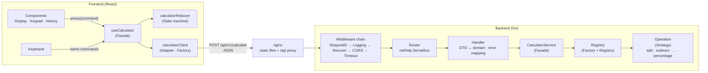

# Calculator: React + Go

A full-stack calculator built for the Sezzle technical assessment. A **React + TypeScript** single-page app takes input, validates it as the user types and shows results; a **Go REST microservice** does the arithmetic (add, subtract, multiply, divide, power, square root and percentage). The backend handles edge cases such as division by zero and overflow, and every error is a typed JSON response. Both layers are unit-tested and well above their coverage targets. One `docker compose up --build` command runs the whole stack.

---

## Contents

1. [Tech stack](#tech-stack)
2. [Quick start (Docker)](#quick-start-docker)
3. [Local setup without Docker](#local-setup-without-docker)
4. [Tests and coverage](#tests-and-coverage)
5. [API reference](#api-reference)
6. [Architecture](#architecture)
7. [Design decisions and assumptions](#design-decisions-and-assumptions)
8. [Project structure](#project-structure)
9. [Possible future improvements](#possible-future-improvements)
10. [AI usage](#ai-usage)

---

## Tech stack

| Layer    | Technology                                                                                                                                      |
| -------- | ----------------------------------------------------------------------------------------------------------------------------------------------- |
| Backend  | Go 1.27, standard library only (`net/http` with method-based routing patterns, `log/slog`, `encoding/json`); `testing` + `httptest`; golangci-lint v2 |
| Frontend | React 19, TypeScript 6 (strict), Vite 8, CSS Modules + CSS custom properties                                                                     |
| Testing  | Vitest 5 (v8 coverage), React Testing Library, user-event, MSW 3                                                                                  |
| Quality  | ESLint 10 (`typescript-eslint` strict, type-checked), Prettier 3, `.editorconfig`                                                                 |
| Delivery | Multi-stage Dockerfiles (distroless backend, `nginx:alpine` frontend), Docker Compose, GitHub Actions                                             |

The backend has **zero third-party dependencies** (`go.mod` has no `require` block).

---

## Quick start (Docker)

Requirements: Docker with Compose v2.

```bash
docker compose up --build        # or: make up   (detached)
```

| URL                                    | What                                  |
| -------------------------------------- | ------------------------------------- |
| <http://localhost:3000>                | The calculator UI (nginx)             |
| <http://localhost:3000/api/v1/...>     | API proxied by nginx (same origin)    |
| <http://localhost:8080/api/v1/...>     | API directly (for `curl` and testing) |

The frontend container only starts once the backend's health check passes. Stop everything with `docker compose down` (or `make down`).

---

## Local setup without Docker

### Prerequisites

| Tool          | Version                        | Needed for                    |
| ------------- | ------------------------------ | ----------------------------- |
| Go            | 1.27+                          | backend                       |
| Node.js       | 24 LTS+ (also tested on 26)    | frontend                      |
| npm           | 10+                            | frontend                      |
| golangci-lint | v2.x                           | `make lint` only              |
| GNU Make      | any                            | convenience targets           |

### Backend

```bash
cd backend
make run                 # or: go run ./cmd/server   → http://localhost:8080
```

Configuration (environment variables, all optional):

| Variable               | Default                                       | Description                                         |
| ---------------------- | --------------------------------------------- | --------------------------------------------------- |
| `PORT`                 | `8080`                                        | Listen port (1–65535)                               |
| `CORS_ALLOWED_ORIGINS` | `http://localhost:5173,http://localhost:3000` | Comma-separated allowed origins; `*` allows any     |
| `LOG_LEVEL`            | `info`                                        | `debug`, `info`, `warn` or `error`                  |

Invalid values make the service exit at startup with a clear error rather than run misconfigured.

### Frontend

```bash
cd frontend
npm ci
npm run dev              # → http://localhost:5173
```

The Vite dev server proxies `/api` to `http://localhost:8080`, so start the backend first. The proxy target can be changed with `VITE_PROXY_TARGET`. The browser-side base URL is `VITE_API_BASE_URL` (default `/api/v1`; see `frontend/.env.example`).

| Script                  | Purpose                                   |
| ----------------------- | ----------------------------------------- |
| `npm run dev`           | Dev server with hot reload                |
| `npm run build`         | Type-check and build to `dist/`           |
| `npm test`              | Run the test suite once                   |
| `npm run test:coverage` | Tests + coverage report (thresholds enforced) |
| `npm run lint`          | ESLint (zero warnings allowed)            |
| `npm run format`        | Prettier (write); `format:check` to verify |
| `npm run typecheck`     | TypeScript project check                  |

---

## Tests and coverage

From the repository root:

```bash
make test             # backend (race detector) + frontend
make coverage         # backend: coverage.out + coverage.html; frontend: frontend/coverage/
make coverage-report  # runs the coverage suites and regenerates docs/coverage.md + the summary below
make lint             # golangci-lint, ESLint, tsc, Prettier
```

Or per layer: `cd backend && make test | make coverage | make lint`, and `cd frontend && npm test | npm run test:coverage`.

Coverage gates are enforced, both locally and in CI. `make coverage` fails if backend coverage of `internal/` drops below **90%**, and Vitest fails if frontend statements, branches, functions or lines drop below **85%**.

### Coverage report

- **Committed report:** [`docs/coverage.md`](docs/coverage.md) has the full per-function backend report (`go tool cover -func`), the per-file frontend report (Vitest v8), the generation date and the exact commands used. It is produced by `make coverage-report` from real runs; nothing in it is typed by hand.
- **HTML reports in CI:** every CI run uploads them as GitHub Actions artifacts. Open the run in the repository's **Actions** tab and download `backend-coverage` (`coverage.out` + `coverage.html`) or `frontend-coverage` (the `coverage/` folder; open `index.html`). They are uploaded even when a threshold fails.
- **HTML reports locally:** run `make coverage`, then open `backend/coverage.html` and `frontend/coverage/index.html`. These files are gitignored.

### Coverage summary

<!-- coverage-summary:start -->
<!-- Generated by `make coverage-report`; do not edit by hand. -->

**Backend**: 174 passing tests and subtests, **99.0%** total statement coverage of `internal/`

| Package | Statements |
| ------- | ---------- |
| `internal/config` | 100.0% |
| `internal/domain` | 100.0% |
| `internal/operations` | 100.0% |
| `internal/registry` | 100.0% |
| `internal/service` | 100.0% |
| `internal/transport/http` | 98.5% |
| **Total** | **99.0%** |

**Frontend**: 243 passing tests in 15 files

| Metric | Coverage |
| ------ | -------- |
| Statements | 100% (236/236) |
| Branches | 98.85% (173/175) |
| Functions | 100% (71/71) |
| Lines | 100% (233/233) |

<!-- coverage-summary:end -->

What is tested:

- **Backend:** every operation, the registry, the service, the error mapper, each middleware, the server lifecycle (graceful shutdown) and every handler path. Tests are table-driven and use `httptest`, with one test for every edge case listed in the API reference.
- **Frontend:**
  - Every state-machine transition, the validation and formatting helpers, and the API adapter (success, each error code, network failure, abort).
  - The `useCalculator` hook, including stale-request cancellation.
  - Each component.
  - MSW-backed integration flows: `12 ÷ 4 = 3`, division by zero, keyboard-only input, loading state and double-submit prevention, network failure, and chaining.

---

## API reference

Base path: `/api/v1`. All responses are JSON (`Content-Type: application/json; charset=utf-8`). Every response carries an `X-Request-ID` header; a client-supplied value is reused if it is 1–64 characters from `[A-Za-z0-9._-]`.

### `GET /api/v1/health`

```bash
curl -s http://localhost:8080/api/v1/health
# {"status":"ok"}
```

### `GET /api/v1/operations`

Lists the supported operations in display order.

```bash
curl -s http://localhost:8080/api/v1/operations
```

```json
{
  "operations": [
    { "name": "add", "symbol": "+", "arity": 2 },
    { "name": "subtract", "symbol": "−", "arity": 2 },
    { "name": "multiply", "symbol": "×", "arity": 2 },
    { "name": "divide", "symbol": "÷", "arity": 2 },
    { "name": "power", "symbol": "^", "arity": 2 },
    { "name": "sqrt", "symbol": "√", "arity": 1 },
    { "name": "percentage", "symbol": "%", "arity": 2 }
  ]
}
```

### `POST /api/v1/calculate`

**Request**

| Field       | Type       | Rules                                                                 |
| ----------- | ---------- | --------------------------------------------------------------------- |
| `operation` | `string`   | Required. One of the names above (case-sensitive).                    |
| `operands`  | `number[]` | Exactly `arity` finite numbers. `null` elements are rejected.         |

Unknown fields, trailing data after the object and bodies over **4 KiB** are rejected.

**Success: `200 OK`**

```json
{ "operation": "divide", "operands": [10, 4], "result": 2.5 }
```

**Error: `4xx`/`5xx`**

```json
{ "error": { "code": "DIVISION_BY_ZERO", "message": "division by zero is not allowed" } }
```

`code` is a stable, machine-readable identifier (the frontend maps it to a friendly message). `message` is a human-readable English explanation.

#### Operations

| Operation    | Arity | Meaning                      | Example                    |
| ------------ | ----- | ---------------------------- | -------------------------- |
| `add`        | 2     | `a + b`                      | `[2, 3]` → `5`             |
| `subtract`   | 2     | `a − b`                      | `[10, 4]` → `6`            |
| `multiply`   | 2     | `a × b`                      | `[6, 7]` → `42`            |
| `divide`     | 2     | `a ÷ b`                      | `[10, 4]` → `2.5`          |
| `power`      | 2     | `a` raised to `b`            | `[2, 10]` → `1024`         |
| `sqrt`       | 1     | principal square root of `a` | `[16]` → `4`               |
| `percentage` | 2     | `a` percent of `b` = `(a / 100) × b` | `[20, 50]` → `10`  |

#### Error codes

| HTTP | Code                    | When                                                                  |
| ---- | ----------------------- | --------------------------------------------------------------------- |
| 400  | `INVALID_REQUEST`       | Empty body, malformed JSON, unknown field, wrong type, number outside the float64 range, not a single object, missing `operation` |
| 413  | `PAYLOAD_TOO_LARGE`     | Body larger than 4 KiB                                                |
| 400  | `UNSUPPORTED_OPERATION` | Unknown operation name                                                |
| 400  | `INVALID_OPERAND_COUNT` | Number of operands does not match the operation's arity              |
| 400  | `INVALID_OPERAND`       | An operand is `null` (or not finite)                                  |
| 422  | `DIVISION_BY_ZERO`      | `divide` with `b = 0`                                                 |
| 422  | `NEGATIVE_SQUARE_ROOT`  | `sqrt` of a negative number                                           |
| 422  | `RESULT_OVERFLOW`       | Result is `±Inf` (e.g. `power(10, 400)`, `multiply(1e308, 10)`)       |
| 422  | `UNDEFINED_RESULT`      | Result is `NaN` (e.g. `power(-8, 0.5)`) or `power(0, negative)`       |
| 404  | `NOT_FOUND`             | Unknown route                                                         |
| 405  | `METHOD_NOT_ALLOWED`    | Known route, wrong method (the `Allow` header lists the right one)    |
| 503  | `REQUEST_TIMEOUT`       | The request exceeded the server-side deadline (5 s)                   |
| 500  | `INTERNAL_ERROR`        | Unexpected failure (details are logged, never returned)               |

#### `curl` examples: every operation

```bash
API=http://localhost:8080/api/v1/calculate
H='Content-Type: application/json'

curl -s -X POST $API -H "$H" -d '{"operation":"add","operands":[2,3]}'
# {"operation":"add","operands":[2,3],"result":5}

curl -s -X POST $API -H "$H" -d '{"operation":"subtract","operands":[10,4]}'
# {"operation":"subtract","operands":[10,4],"result":6}

curl -s -X POST $API -H "$H" -d '{"operation":"multiply","operands":[6,7]}'
# {"operation":"multiply","operands":[6,7],"result":42}

curl -s -X POST $API -H "$H" -d '{"operation":"divide","operands":[10,4]}'
# {"operation":"divide","operands":[10,4],"result":2.5}

curl -s -X POST $API -H "$H" -d '{"operation":"power","operands":[2,10]}'
# {"operation":"power","operands":[2,10],"result":1024}

curl -s -X POST $API -H "$H" -d '{"operation":"sqrt","operands":[16]}'
# {"operation":"sqrt","operands":[16],"result":4}

curl -s -X POST $API -H "$H" -d '{"operation":"percentage","operands":[20,50]}'
# {"operation":"percentage","operands":[20,50],"result":10}
```

#### `curl` examples: every error case

```bash
# 422 DIVISION_BY_ZERO
curl -s -X POST $API -H "$H" -d '{"operation":"divide","operands":[10,0]}'
# {"error":{"code":"DIVISION_BY_ZERO","message":"division by zero is not allowed"}}

# 422 NEGATIVE_SQUARE_ROOT
curl -s -X POST $API -H "$H" -d '{"operation":"sqrt","operands":[-4]}'
# {"error":{"code":"NEGATIVE_SQUARE_ROOT","message":"square root of a negative number is not allowed"}}

# 422 RESULT_OVERFLOW
curl -s -X POST $API -H "$H" -d '{"operation":"power","operands":[10,400]}'
# {"error":{"code":"RESULT_OVERFLOW","message":"result is too large to represent"}}

# 422 UNDEFINED_RESULT
curl -s -X POST $API -H "$H" -d '{"operation":"power","operands":[0,-1]}'
# {"error":{"code":"UNDEFINED_RESULT","message":"result is undefined"}}

# 400 UNSUPPORTED_OPERATION
curl -s -X POST $API -H "$H" -d '{"operation":"modulo","operands":[10,3]}'
# {"error":{"code":"UNSUPPORTED_OPERATION","message":"unsupported operation: \"modulo\""}}

# 400 INVALID_OPERAND_COUNT
curl -s -X POST $API -H "$H" -d '{"operation":"add","operands":[1]}'
# {"error":{"code":"INVALID_OPERAND_COUNT","message":"operation \"add\" expects 2 operand(s), got 1"}}

# 400 INVALID_OPERAND
curl -s -X POST $API -H "$H" -d '{"operation":"add","operands":[null,2]}'
# {"error":{"code":"INVALID_OPERAND","message":"operand at index 0 must be a number"}}

# 400 INVALID_REQUEST: empty body
curl -s -X POST $API -H "$H"
# {"error":{"code":"INVALID_REQUEST","message":"request body must not be empty"}}

# 400 INVALID_REQUEST: malformed JSON
curl -s -X POST $API -H "$H" -d '{"operation":'
# {"error":{"code":"INVALID_REQUEST","message":"request body contains malformed JSON"}}

# 400 INVALID_REQUEST: unknown field
curl -s -X POST $API -H "$H" -d '{"operation":"add","operands":[1,2],"precision":2}'
# {"error":{"code":"INVALID_REQUEST","message":"request body contains unknown field \"precision\""}}

# 400 INVALID_REQUEST: wrong type
curl -s -X POST $API -H "$H" -d '{"operation":"add","operands":["1",2]}'
# {"error":{"code":"INVALID_REQUEST","message":"field \"operands.0\" has an invalid value"}}

# 400 INVALID_REQUEST: missing operation
curl -s -X POST $API -H "$H" -d '{"operands":[1,2]}'
# {"error":{"code":"INVALID_REQUEST","message":"field \"operation\" is required"}}

# 413 PAYLOAD_TOO_LARGE
curl -s -X POST $API -H "$H" -d "{\"operation\":\"add\",\"operands\":[1,2]}$(printf '%*s' 5000 '')"
# {"error":{"code":"PAYLOAD_TOO_LARGE","message":"request body must not exceed 4096 bytes"}}

# 405 METHOD_NOT_ALLOWED (with "Allow: POST")
curl -s http://localhost:8080/api/v1/calculate
# {"error":{"code":"METHOD_NOT_ALLOWED","message":"method GET is not allowed on /api/v1/calculate"}}

# 404 NOT_FOUND
curl -s http://localhost:8080/api/v1/unknown
# {"error":{"code":"NOT_FOUND","message":"route /api/v1/unknown not found"}}
```

`REQUEST_TIMEOUT` and `INTERNAL_ERROR` cannot be triggered with a normal request; they are covered by unit tests.

---

## Architecture



**Backend layers:**
- `domain` holds abstractions and typed errors; it has no outward dependencies.
- `operations` holds one strategy per operation.
- `registry` resolves an operation name to its strategy.
- `service` holds the use case.
- `transport/http` holds everything HTTP.
- `cmd/server/main.go` only wires them together.

Dependencies point inwards: `transport → service → domain`. Each consumer declares the interface it needs (`service.OperationRegistry`, `httptransport.Calculator`), so any layer can be tested with a fake.

**Frontend layers:**
- `domain` holds pure types, the operation config, validation, formatting and errors.
- `features/calculator` holds commands, the reducer, selectors, hooks and components.
- `api` holds the HTTP client and its context.
- `components/ui` holds reusable presentational components; `theme` holds the design tokens.

---

## Design decisions and assumptions

### Patterns used and why

**Backend**

| Pattern | Where | Why it earns its place |
| --- | --- | --- |
| **Strategy** | `domain.Operation` + one type per file in `operations/` | Each algorithm is isolated and testable on its own; the service never switches on operation names. |
| **Factory + Registry** | `registry.New(ops...)`, `Get(name)` | Name→strategy resolution lives in one place and fails fast at startup (nil, empty or duplicate names). Adding an operation means one new file plus one line in `operations.All()` (Open/Closed). |
| **Facade** | `service.CalculatorService.Calculate(ctx, op, operands)` | Callers make a single call. Lookup, arity and finiteness checks, NaN/Inf detection and `-0` normalization stay hidden. |
| **Adapter** | `transport/http/dto.go` | Wire types (JSON tags, `*float64` to detect `null`) stay out of the domain. |
| **Decorator / Chain of Responsibility** | `Middleware func(http.Handler) http.Handler` + `Chain` | Each cross-cutting concern is a small, independently tested function; their order is explicit in `main.go`. |
| **Functional options (Builder)** | `NewServer(handler, WithAddr(...), ...)` | Safe defaults, readable call sites, no long constructor parameter lists. |
| **Dependency injection** | constructors and interfaces declared where they're used, wired in `main.go` | No globals, no `init()`; every layer can be tested with a fake. |

A **single error mapper** (`toAPIError`) is the only place that knows how errors become HTTP status codes and API codes. The domain uses sentinel errors (`errors.Is`) plus typed errors carrying details (`UnsupportedOperationError`, `OperandCountError`, matched with `errors.As`). Unknown errors become a generic 500; their details go to the logs only.

**Frontend**

| Pattern | Where | Why it earns its place |
| --- | --- | --- |
| **State machine** | `calculatorReducer.ts` (pure `useReducer` reducer, discriminated union) | Each state carries only its own data, so impossible combinations can't be represented; transitions are exhaustively unit-tested without React. |
| **Command** | `commands.ts`, `keyboard.ts`, `keypad.ts` | On-screen keys and the keyboard dispatch identical typed commands, so there is one logic path to test. |
| **Adapter** | `api/calculatorClient.ts`, `api/dto.ts` | Backend DTOs and error payloads become domain values and a typed `CalculatorError`; nothing else knows the wire format. |
| **Facade** | `useCalculator()` | Components only see `state`/`display` and `press(command)`; the reducer, the client and the request lifecycle stay hidden. |
| **Factory** | `createCalculatorClient({ baseUrl, fetch })`; operator keys generated from `domain/operations.ts` | Inject `fetch` in tests; adding an operation to the config adds its button and shortcut. |
| **Dependency injection** | `CalculatorClientContext` | Production gets the HTTP client; tests inject a fake or the MSW-backed client. |
| **Container / presentational split** | `Calculator` vs. `Display`, `Keypad`, `History`, `Button` | Presentational components are pure functions of their props and trivial to test. |

### Why the standard library instead of a web framework

Go 1.22+ routing patterns (`"POST /api/v1/calculate"`) cover everything this API needs. Adding a framework would add dependencies and an abstraction layer for no functional gain. The stdlib has a stable API, is well documented and has a minimal supply-chain footprint. One quirk needed handling: `ServeMux` answers 404 and 405 in plain text, so the router registers explicit JSON fallbacks for both.

### Why calculations happen in the backend

The assignment frames the backend as the calculation service. The frontend only validates input, so there is one source of truth for results and edge cases. It never computes results; even display formatting only rounds what the API returned.

### Numeric precision: `float64`

Both layers use IEEE-754 doubles: Go's `float64` and JavaScript's `number`. A decimal library was **not** used:

- JSON numbers are parsed as doubles by browsers anyway, so exact decimals would also require changing the wire format to strings.
- `power` and `sqrt` are irrational for most inputs, so a decimal type only helps the four basic operations.
- The cost (dependencies, string operands, a harder API) isn't justified for a general-purpose calculator.

To keep results readable:

- The UI shows up to 15 significant digits, the most a double holds exactly in decimal, so `0.1 + 0.2` displays as `0.3`.
- Very large or very small results switch to exponent notation.
- Continuing a calculation from a result uses the full-precision value, not the rounded one.
- The backend turns `-0` into `0`.

### Percentage semantics

`percentage(a, b)` means **"`a` percent of `b`"**, i.e. `(a / 100) × b`: `percentage(20, 50) = 10`. On the keypad it is a binary operator: `20 % 50 =` → `10`.

### Error-code design

- **400 vs 422:** 400 means the request itself is wrong (shape, types, operation name, operand count). 422 means the request is well-formed but the maths can't produce a real, finite number.
- **Stable codes:** codes are `UPPER_SNAKE_CASE` constants, so clients branch on `code` and never parse `message`.
- **Error detection:** NaN and ±Inf are caught centrally in the service, so every current and future operation gets overflow and NaN checks for free.
- **`power(0, negative)`:** Go returns `+Inf` here, but it's really a division by zero, so it's reported as `UNDEFINED_RESULT` rather than overflow.
- **Beyond the spec's list:** `INVALID_REQUEST`, `PAYLOAD_TOO_LARGE`, `INVALID_OPERAND`, `NOT_FOUND`, `METHOD_NOT_ALLOWED`, `REQUEST_TIMEOUT` and `INTERNAL_ERROR` were added so every failure has a precise, documented code.

### Other decisions and assumptions

**Backend**

- **`Symbol()` on the interface:** `Operation` exposes `Symbol()` in addition to the required `Name()`, `Arity()` and `Apply()`, because `GET /operations` returns symbols.
- **Exact, case-sensitive names:** operation names must match exactly (`ADD` is rejected), keeping the API strict and predictable.
- **Numbers outside the float64 range:** `1e400` is rejected at decoding time with `INVALID_REQUEST`. `null` operands are rejected rather than silently decoded as `0`.
- **`Content-Type` isn't enforced,** so `curl -d` without a header works; the body must still be valid JSON.
- **Timeouts:** the `Timeout` middleware puts a deadline on each request. Go's `http.TimeoutHandler` wasn't used because it replies in plain text.
- **Server timeouts:** read-header (2 s), read (5 s), write (10 s) and idle (60 s) timeouts, with graceful shutdown on SIGINT and SIGTERM (10 s budget).
- **Request IDs:** a client-supplied `X-Request-ID` is accepted only if it's short and URL-safe, so clients can't inject text into the logs.

**Frontend: calculator behavior**

- **Chaining:** `2 + 3 ×` sends `2 + 3` first, then continues with `5 ×`.
- **√ applies immediately** to the value being entered or to the last result. While a binary operation is waiting for its second operand, √ is ignored, which avoids nested pending calculations.
- **Inputs ignored by design:**
  - An operator with no number typed yet.
  - `=` without a second operand.
  - Every key except C while a request is in flight; `=` is also disabled, which prevents double submits.
- **Errors:** any key clears the error message, and typing a number starts a new calculation.
- **Input limits:** one decimal point and at most 15 digits per number. There is no ± key (not in the spec), so negative numbers come only from results, e.g. `2 − 5`.
- **No stale results:** a pending request is cancelled (`AbortController`) as soon as the state changes, e.g. on C.
- **Session history:** the last 5 successful calculations are shown (the optional feature); nothing is persisted.

**Frontend: keyboard, accessibility, styling and tooling**

- **Keyboard map:**
  - Digits; `.` or `,` for the decimal point.
  - `+ - * x / ^ %` for the operators, and `r` for √.
  - `Enter` or `=` for equals, `Backspace` to delete, `Escape` or `Delete` to clear.
  - Shortcuts that use Ctrl, Alt or Cmd are left to the browser.
- **Accessibility:**
  - Symbol keys have `aria-label`s, and the result is announced through `aria-live="polite"`.
  - The pending operator is marked as pressed (`aria-pressed`), and the display is marked busy while loading.
  - Focus outlines are visible.
  - The color palette was checked for WCAG AA contrast (e.g. white on `#8333D4` ≈ 6.2:1).
- **Styling:**
  - The palette is inspired by Sezzle's brand tone; no logo, wordmark or brand assets are used.
  - The font stack starts with Inter but uses only installed fonts, so the app makes no external requests.
  - Animations are turned off when the user prefers reduced motion.
- **TypeScript is pinned to 6.0,** because `typescript-eslint` does not support TypeScript 7 yet.

**Infrastructure**

- **Same-origin API in Docker:** nginx forwards `/api/`, so the browser needs no CORS there. CORS stays configurable for direct API use.
- **Healthcheck binary:** the backend image is distroless (non-root, no shell), so a ~40-line `cmd/healthcheck` binary probes `/api/v1/health` for Docker's health check.
- **Port 8080 is also published,** so the `curl` examples above work against the containerized API.
- **Repository root:** the repository root itself holds `backend/` and `frontend/`, rather than a nested `sezzle-calculator/` folder.

---

## Project structure

```
.
├── backend/
│   ├── cmd/
│   │   ├── server/main.go            # composition root (wiring only)
│   │   └── healthcheck/main.go       # container health probe
│   ├── internal/
│   │   ├── config/                   # env-based configuration
│   │   ├── domain/                   # Operation interface, typed errors
│   │   ├── operations/               # one Strategy per file + All()
│   │   ├── registry/                 # Factory + Registry
│   │   ├── service/                  # CalculatorService (Facade)
│   │   └── transport/http/           # router, handlers, DTOs, error mapper, middleware, server
│   ├── Dockerfile
│   ├── Makefile
│   ├── .golangci.yml
│   └── go.mod
├── frontend/
│   ├── src/
│   │   ├── api/                      # calculatorClient (Adapter/Factory), DTOs, client context
│   │   ├── components/ui/            # Button, Spinner, cx helper
│   │   ├── domain/                   # operations config, validation, formatting, errors
│   │   ├── features/calculator/
│   │   │   ├── components/           # Calculator (container), Display, Keypad, History
│   │   │   ├── calculatorReducer.ts  # state machine
│   │   │   ├── commands.ts           # typed commands and events
│   │   │   ├── keyboard.ts, keypad.ts
│   │   │   ├── selectors.ts
│   │   │   ├── useCalculator.ts      # Facade hook
│   │   │   └── useKeyboardCommands.ts
│   │   ├── theme/                    # tokens.css, global.css
│   │   ├── test/                     # MSW API mock, render helper, setup
│   │   ├── App.tsx
│   │   └── main.tsx
│   ├── Dockerfile
│   ├── nginx.conf
│   ├── vite.config.ts
│   └── package.json
├── .github/workflows/ci.yml          # lint, test, coverage, Docker e2e smoke test
├── docker-compose.yml
├── Makefile                          # make test | coverage | lint | up | down
├── PROMPTS.md
└── README.md
```

---

## Possible future improvements

- **Exact decimal arithmetic** (e.g. `math/big.Rat` with string operands) for money-grade precision on the basic operations.
- **OpenAPI specification** generated or checked in, plus contract tests shared by the MSW mock and the Go handlers.
- **Browser end-to-end tests** (Playwright) and visual regression tests for the responsive layout.
- **Observability:** Prometheus metrics and OpenTelemetry traces keyed by the existing request ID.
- **Rate limiting** and a stricter Content Security Policy at the edge.
- **More calculator features:** a ± key, parentheses and expression parsing, memory keys, persisted history, dark mode and locale-aware number formatting.

---

## AI usage

This project was built with **Claude Code** (Anthropic), driven phase by phase from a single specification prompt. Each phase was reviewed and committed separately. The full prompt, plus the short follow-up messages used to advance each phase, is in [`PROMPTS.md`](PROMPTS.md).
